# Home Assistant

  

Things I built for my own Home Assistant and use every day.

Most of it is about energy: use as much of my own solar power as possible, and
buy the rest in the cheapest quarter-hours of my dynamic contract. The goal is
to make the energy bill as low as possible.

## Contents

| folder | what is in it |
|---|---|
| [`automations/`](automations/) | Automations for the home battery, dishwasher, hot water and heat pump, a reminder for empty sensor batteries, and a watch on topping up the rainwater tank |
| [`cards/`](cards/) | Dashboard cards, such as a pop-up with every parcel on its way |

The solar panels have their own repo: [homeassistant-apsystems_modbus](https://github.com/christianvaes/homeassistant-apsystems_modbus) reads the APsystems inverters. Curtailing them when exporting costs money comes next.
