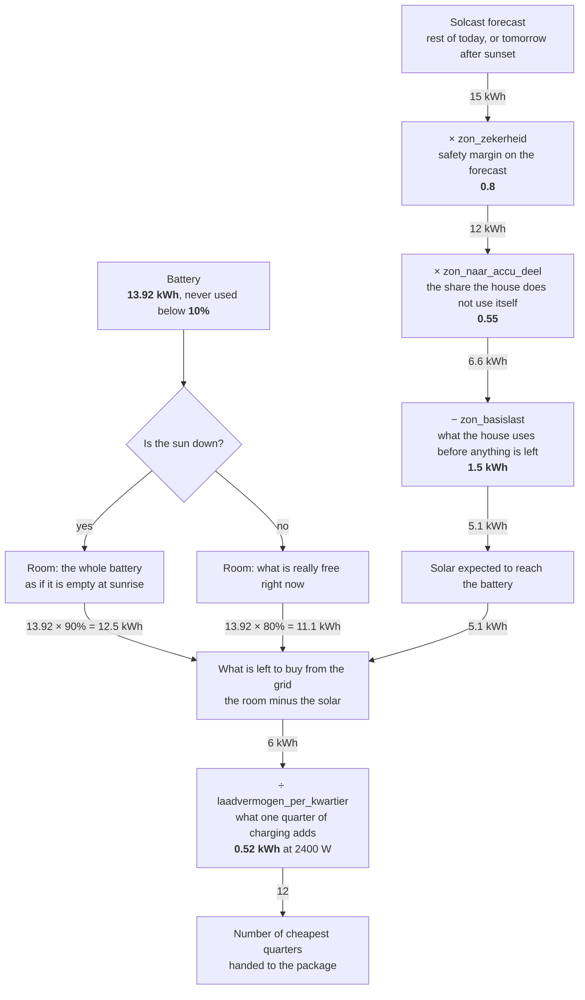

# Home Assistant automations

Automations that let appliances follow the electricity price and use the solar
left over. Each one is a separate YAML file.

## Files

| file | what it does |
|---|---|
| [`accu_dagplan_en_bijplan.yaml`](accu_dagplan_en_bijplan.yaml) | Fills the Zendure battery with solar and buys the rest in the cheapest quarter-hours, planned on the solar forecast. Sets the battery mode |
| [`vaatwasser_starten_op_de_goedkoopste_prijs.yaml`](vaatwasser_starten_op_de_goedkoopste_prijs.yaml) | Starts auto 2 on the Siemens dishwasher, delayed until the cheapest window, or earlier when solar is being exported |
| [`boiler_verhogen_zonoverschot.yaml`](boiler_verhogen_zonoverschot.yaml) | Raises the hot water setpoint on the Ecoforest heat pump when there is really solar left over |
| [`warmtepomp_koeling_uit_bij_hoge_stroomprijs.yaml`](warmtepomp_koeling_uit_bij_hoge_stroomprijs.yaml) | Turns the Ecoforest heat pump off above EUR 0.50 per kWh when warm weather is forecast |

## Hardware

What I run. Other models from the same brands work, with different entity IDs.

- **Zendure SolarFlow** home battery (mine is a 2400 AC+)
- **Ecoforest** heat pump with its domestic hot water tank, controlled through
  an Eplucon Th-touch
- **Siemens** dishwasher on Home Connect
- **HomeWizard P1** meter, for grid import and export

## Battery charging/discharging logic

[`accu_dagplan_en_bijplan.yaml`](accu_dagplan_en_bijplan.yaml) makes two decisions: which mode
the battery runs in, and how much it tops up from the grid.

### Choosing the mode

Every quarter-hour it picks a mode, based on the solar left over, the price, and whether the
forecast fills the battery without the grid.

| rule | solar left over | price | battery | what happens | mode |
|---|---|---|---|---|---|
| 1 | any | planned charging quarter | any | the battery charges from the grid, the house buys its own power | `Dynamisch NOM` |
| 2 | excluded appliance running | any | any | the house buys from the grid, the battery does not discharge at all | `Alleen slim opladen` |
| 3 | no | not among the most expensive quarters it can still cover | too little until the next charge, and the sun will not fill it | the house buys, and the battery waits for the more expensive quarters ahead | `Alleen slim opladen` |
| 4 | any | any | the sun fills it | the battery supplies the house, solar surplus goes in | `Nul op de meter` |
| 5 | any | any | enough until the next charge, or one of the most expensive quarters | the battery supplies the house, also at night when power is cheap | `Dynamisch NOM` |

The mode names are Dutch, they come from the Gielz zenSDK package. Outside the
charging quarters `Nul op de meter` and `Dynamisch NOM` behave the same; the
difference only shows whether the sun fills the battery.

Rule 3, every quarter: the automation works out how many quarters the house can
still run on what is in the battery, using an average house load, and looks at
the prices from now until the next charge, today and tomorrow together.

- From the grid: a charging block of at least an hour of planned charging
  quarters in a row. A single planned quarter adds only 4 percent and does not
  count.
- From the sun, if no charging block is coming: the first half hour in which
  Solcast, with the margin, expects more solar than the house draws. This only
  counts when the sun then puts at least an hour of charging into the battery,
  so a single sunny half hour in winter does not count.

If the battery cannot cover all quarters until then, it is kept for the most
expensive ones and the house buys the rest from the grid. If it can, it just
discharges.

The excluded appliances are optional: a list of power sensors, for example a car
charger, with one threshold above which an appliance counts as running. Leave
the list empty and the row above never applies. Grid charging in the planned
cheap quarters keeps working while an appliance runs, only discharging stops.

### Topping up from the grid

When the sun is not expected to fill the battery, the automation buys the rest in the cheapest
quarters of the day. This is how it works out how much that is.

The settings in the boxes are mine. [Measured assumptions](#measured-assumptions) says where they
come from. The values on the arrows follow the example at the end of this section.

The forecast covers the rest of today, not the whole day, so it shrinks as the day goes on.
The package counts the cheapest quarters of the whole day, including ones already past, so the
automation looks for the position in the price list where exactly the quarters it wants are
still ahead. That is why the number it writes keeps growing during the day, even when the
battery needs less than it did an hour earlier. A quarter only counts when its price, after
the round-trip loss, is still below the day average: charging dearer than that costs more
than it saves. During the day that is the average of today, after sunset the average of today
and tomorrow together.

After sunset the quarters left today compete with all of tomorrow's. A quarter tonight is only
bought when it is cheaper than what tomorrow offers. Without this the automation would buy the
last quarters of the day just because the cheap ones were gone, not because they were cheap.

**A worked example.** A forecast of 15 kWh with the battery at 20 percent. The margin leaves
12 kWh, of which 0.55 × 12 − 1.5 = 5.1 kWh is expected to reach the battery. The battery
holds 13.92 kWh, so at 20 percent there is 11.1 kWh of room. That leaves 11.1 − 5.1 = 6 kWh
to buy from the grid: 6 ÷ 0.52 = **12 quarters**.

## Dependencies

Not every automation needs everything.

| automation | needs |
|---|---|
| [`accu_dagplan_en_bijplan.yaml`](accu_dagplan_en_bijplan.yaml) | zenSDK package, Solcast, Nordpool, and optionally power sensors on appliances during which the battery must not discharge |
| [`vaatwasser_starten_op_de_goedkoopste_prijs.yaml`](vaatwasser_starten_op_de_goedkoopste_prijs.yaml) | Home Connect, Nordpool, and the P1 meter |
| [`boiler_verhogen_zonoverschot.yaml`](boiler_verhogen_zonoverschot.yaml) | Tech Controllers, zenSDK package, the P1 meter, and a power meter on the heat pump circuit |
| [`warmtepomp_koeling_uit_bij_hoge_stroomprijs.yaml`](warmtepomp_koeling_uit_bij_hoge_stroomprijs.yaml) | Tech Controllers, Nordpool, and a sensor with today's forecast high, from any weather integration |

| integration | provides |
|---|---|
| [Zendure zenSDK package](https://github.com/Gielz1986/Zendure-HA-zenSDK) | the battery entities, the mode selector and the dynamic price sensors. Keep its minimum spread at 25 percent or lower, above that it can refuse the planned quarters |
| [Solcast](https://github.com/BJReplay/ha-solcast-solar) | the solar forecast for today and tomorrow, as totals and per half hour (the `detailedForecast` attribute) |
| [Nordpool](https://github.com/custom-components/nordpool/) | the quarter-hour prices, tax and surcharges included. Take the HACS one, not the Nord Pool integration that ships with Home Assistant |
| [Home Connect](https://www.home-assistant.io/integrations/home_connect) | the dishwasher door, program, remote start and the delayed start time |
| [Tech Controllers](https://github.com/mariusz-ostoja-swierczynski/tech-controllers) | the heat pump: the hot water setpoint and the on/off switch |
| [Eplucon](https://github.com/koenhendriks/ha-eplucon) | readings from the same heat pump, used here only for the water temperature in a notification |

## Measured assumptions

The numbers in [`accu_dagplan_en_bijplan.yaml`](accu_dagplan_en_bijplan.yaml) come from measurements on my own
installation.

| variable | value | source |
|---|---|---|
| `accu_inhoud` | 13.92 kWh | Zendure SolarFlow 2400 AC+ with five packs |
| `laadvermogen_per_kwartier` | 0.52 kWh | 2400 W charging power, times the round trip |
| `zon_naar_accu_deel` | 0.55 | calibrated on 355 days of generation and feed-in |
| `zon_basislast` | 1.5 kWh | same |
| `rendement` | 0.87 | round trip, just below the measured 87.6 percent |
| `zon_zekerheid` | 0.8 | Solcast ran 20 percent high on most days in September 2026; a bigger margin would buy solar you would have had for free |
| `huisverbruik` | 0.55 kW | what the battery delivers per hour at night, measured on 15 September and 8 October 2026; higher in winter because of the heat pump |

[`boiler_verhogen_zonoverschot.yaml`](boiler_verhogen_zonoverschot.yaml) uses a threshold of 2400 W, based on the
measured 2177 W draw during water heating.

[`vaatwasser_starten_op_de_goedkoopste_prijs.yaml`](vaatwasser_starten_op_de_goedkoopste_prijs.yaml) uses these:

| variable | value | source |
|---|---|---|
| `vanaf_teruglevering` | 1500 W | the first heating phase of auto 2 draws 1.42 to 1.51 kW |
| `kwartieren` | 10 | auto 2 takes 2:00 to 2:17 |
