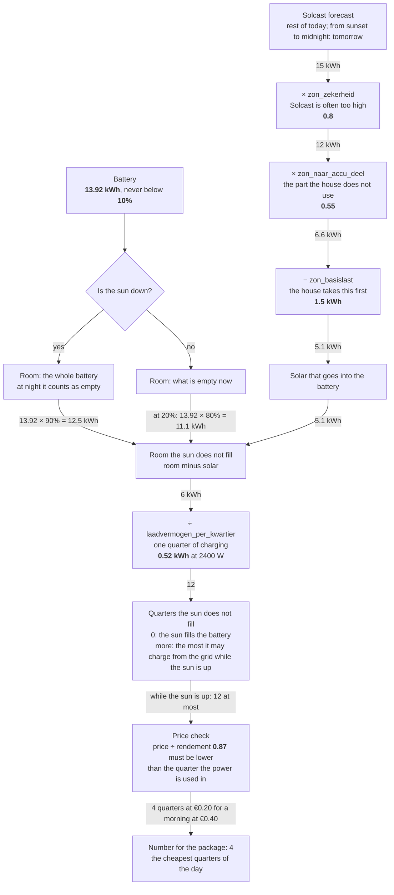

# Home Assistant automations

Automations that let appliances follow the electricity price and use the solar
left over, plus two that keep an eye on the batteries in my sensors and on
topping up the rainwater tank. Each one is a separate YAML file.

## Files

| file | what it does |
|---|---|
| [`accu_dagplan_en_bijplan.yaml`](accu_dagplan_en_bijplan.yaml) | Fills the Zendure battery with solar and uses it for the most expensive quarter-hours. Charges from the grid only when that is cheaper, even after the charging loss. Sets the battery mode |
| [`vaatwasser_starten_op_de_goedkoopste_prijs.yaml`](vaatwasser_starten_op_de_goedkoopste_prijs.yaml) | Starts auto 2 on the Siemens dishwasher, delayed until the cheapest window, or earlier when solar is being exported |
| [`boiler_verhogen_zonoverschot.yaml`](boiler_verhogen_zonoverschot.yaml) | Raises the hot water setpoint on the Ecoforest heat pump when there is really solar left over |
| [`warmtepomp_koeling_uit_bij_hoge_stroomprijs.yaml`](warmtepomp_koeling_uit_bij_hoge_stroomprijs.yaml) | Turns the Ecoforest heat pump off above EUR 0.50 per kWh when warm weather is forecast |
| [`notificatie_batterij_sensoren_leeg.yaml`](notificatie_batterij_sensoren_leeg.yaml) | Sends a notification when a sensor battery drops below 20 percent, and a reminder every morning at 09:00 until it is replaced |
| [`waterput_bijvullen_bewaking.yaml`](waterput_bijvullen_bewaking.yaml) | Watches topping up the rainwater tank with tap water. Closes the valve when a stuck float lets the level pass the maximum, and sends a notification when topping up runs for 4 hours, no water flows, the valve leaks, or the flow meter valve blocks the line |

## Hardware

What I run. Other models from the same brands work, with different entity IDs.

- **Zendure SolarFlow** home battery (mine is a 2400 AC+)
- **Ecoforest** heat pump with its domestic hot water tank, controlled through
  an Eplucon Th-touch
- **Siemens** dishwasher on Home Connect
- **HomeWizard P1** meter, for grid import and export
- **Shelly Wave 2PM** on the rainwater tank: the float switches the tap water
  valve on its own, the automation only watches it. It also needs the tank level
  in percent. Set the 35 percent limit, which appears twice, to the level where
  your float stops topping up plus about 10 percent
- **Sonoff SWV** water valve in the top-up line, used as a flow meter

## Battery charging/discharging logic

[`accu_dagplan_en_bijplan.yaml`](accu_dagplan_en_bijplan.yaml) uses as much of your own solar as
it can, and buys the rest when power is cheap. It decides two things:

- in which quarters the battery charges from the grid
- every quarter-hour, which mode the battery runs in

### How much the sun fills

The settings in the boxes are mine. [Measured assumptions](#measured-assumptions) says where they
come from.

**Example.** Solcast says 15 kWh, the battery is at 20 percent, the sun is up. After the margin
12 kWh is left, and 0.55 × 12 − 1.5 = 5.1 kWh of that goes into the battery. At 20 percent
11.1 kWh is empty, so the sun does not fill 11.1 − 5.1 = 6 kWh: 6 ÷ 0.52 = **12 quarters**. That
is a limit, not a goal. The price check only buys quarters that are cheaper than the quarters the
power is used in: 4 in the diagram. The house buys the rest at the moment itself, without
charging loss.

### The price check: which quarters it charges in

The battery is for the most expensive quarters. The automation walks through the coming quarters
in time order, today and tomorrow once those prices are out (around 13:00). It counts in steps of
one quarter of house use: `huisverbruik` 0.7 kW ÷ 4 = 0.175 kWh.

- A quarter without sun gets the cheapest power there is: what is in the battery, solar, or grid
  power from an earlier quarter at that price ÷ 0.87. Only if that is cheaper than the quarter
  itself, otherwise the house buys.
- A later, more expensive quarter may take that power away from an earlier one.
- It looks ahead until the sun fills the battery, or to the end of the known prices. Grid power
  charged before the sun fills it is only used before then, so in the morning there is room for
  the sun.

An example with one quarter of power in the battery:

| quarter | price | what happens |
|---|---|---|
| A | €0.40 | gets the battery power |
| B | €0.30 | cheaper than A: the power stays with A, B buys from the grid |
| C | €0.50 | more expensive than A: takes the battery power, A now buys from the grid |

Grid charging works the same way. A quarter at €0.20 offers power for 0.20 ÷ 0.87 = €0.23. A later
quarter at €0.40 takes it, so €0.20 becomes a charging quarter; a quarter at €0.22 would not take
it. The package wants one number per day: how many of the cheapest quarters it may charge in.
When the price is negative it always charges, as long as there is room.

### Choosing the mode

Every quarter-hour it picks a mode; the first rule that applies wins.

| rule | solar | price | battery | what happens | mode |
|---|---|---|---|---|---|
| 1 | any | one of the cheapest quarters of the day | any, unless full while an excluded appliance runs | the battery charges from the grid, the house buys its own power | `Dynamisch NOM` |
| 2 | any | any | excluded appliance running | the house buys from the grid, the battery does not discharge but still charges on solar | `Alleen slim opladen` |
| 3 | fills the battery today | cheaper sunny quarters later will fill it | any | solar goes to the grid, the battery waits for those quarters | `Alleen slim ontladen` |
| 4 | any | not a covered quarter | kept for covered quarters ahead | the house buys from the grid | `Alleen slim opladen` |
| 5 | fills the battery | any | any | the battery supplies the house, solar surplus goes in | `Nul op de meter` |
| 6 | any | any | any | the battery supplies the house | `Dynamisch NOM` |

The mode names are Dutch, they come from the Gielz zenSDK package. Outside the charging quarters
`Nul op de meter` and `Dynamisch NOM` behave the same; the difference only shows whether the sun
fills the battery.

Rule 3: without net metering, solar fed in during the morning is worth more than solar stored
then. So when the sun fills the battery anyway, it only takes solar in the cheapest quarters,
usually around noon.

The excluded appliances are optional: a list of power sensors, for example a car charger, with
one threshold above which an appliance counts as running. Leave the list empty and rule 2 never
applies. Grid charging keeps working while an appliance runs, unless the battery is full.

## Dependencies

Not every automation needs everything.

| automation | needs |
|---|---|
| [`accu_dagplan_en_bijplan.yaml`](accu_dagplan_en_bijplan.yaml) | zenSDK package, Solcast, Nordpool, and optionally power sensors on appliances during which the battery must not discharge |
| [`vaatwasser_starten_op_de_goedkoopste_prijs.yaml`](vaatwasser_starten_op_de_goedkoopste_prijs.yaml) | Home Connect, Nordpool, and the P1 meter |
| [`boiler_verhogen_zonoverschot.yaml`](boiler_verhogen_zonoverschot.yaml) | Tech Controllers, zenSDK package, the P1 meter, and a power meter on the heat pump circuit |
| [`warmtepomp_koeling_uit_bij_hoge_stroomprijs.yaml`](warmtepomp_koeling_uit_bij_hoge_stroomprijs.yaml) | Tech Controllers, Nordpool, and a sensor with today's forecast high, from any weather integration |
| [`notificatie_batterij_sensoren_leeg.yaml`](notificatie_batterij_sensoren_leeg.yaml) | a label on the battery percentage sensors to watch, with the label ID `batterij_melding` (name it Batterij melding and Home Assistant gives it that ID), and a notify entity for the messages (mine is `notify.gezin`). The `notities` at the top are optional: text in brackets after a device name, mine say which side of a blind to charge. Replace them with your own sensors or leave them empty with `notities: {}` |

| integration | provides |
|---|---|
| [Zendure zenSDK package](https://github.com/Gielz1986/Zendure-HA-zenSDK) | the battery entities, the mode selector and the dynamic price sensors. Keep its minimum spread at 25 percent or lower, above that it can refuse the planned quarters |
| [Solcast](https://github.com/BJReplay/ha-solcast-solar) | the solar forecast for today and tomorrow, as totals and per half hour (the `detailedForecast` attribute) |
| [Nordpool](https://github.com/custom-components/nordpool/) | the quarter-hour prices, tax and surcharges included. Take the HACS one, not the Nord Pool integration that ships with Home Assistant |
| [Home Connect](https://www.home-assistant.io/integrations/home_connect) | the dishwasher door, program, remote start and the delayed start time |
| [Tech Controllers](https://github.com/mariusz-ostoja-swierczynski/tech-controllers) | the heat pump: the hot water setpoint and the on/off switch |
| [Eplucon](https://github.com/koenhendriks/ha-eplucon) | readings from the same heat pump, used here only for the water temperature in a notification |

## Measured assumptions

The numbers in [`accu_dagplan_en_bijplan.yaml`](accu_dagplan_en_bijplan.yaml) come from measurements on my own
installation.

| variable | value | source |
|---|---|---|
| `accu_inhoud` | 13.92 kWh | Zendure SolarFlow 2400 AC+ with five packs |
| `laadvermogen_per_kwartier` | 0.52 kWh | 2400 W charging power, times the round trip |
| `zon_naar_accu_deel` | 0.55 | calibrated on 355 days of generation and feed-in |
| `zon_basislast` | 1.5 kWh | same |
| `rendement` | 0.87 | round trip, just below the measured 87.9 percent |
| `zon_zekerheid` | 0.8 | Solcast ran 20 percent high on most days in September 2026; a bigger margin would buy solar you would have had for free |
| `huisverbruik` | 0.7 kW | chosen with a year of measurements, November 2025 to October 2026: less at night (0.55), more in the evening (1 to 1.8). Anything between 0.65 and 0.75 gives almost the same result |

[`boiler_verhogen_zonoverschot.yaml`](boiler_verhogen_zonoverschot.yaml) uses a threshold of 2400 W, based on the
measured 2177 W draw during water heating.

[`vaatwasser_starten_op_de_goedkoopste_prijs.yaml`](vaatwasser_starten_op_de_goedkoopste_prijs.yaml) uses these:

| variable | value | source |
|---|---|---|
| `vanaf_teruglevering` | 1500 W | the first heating phase of auto 2 draws 1.42 to 1.51 kW |
| `kwartieren` | 10 | auto 2 takes 2:00 to 2:17 |
