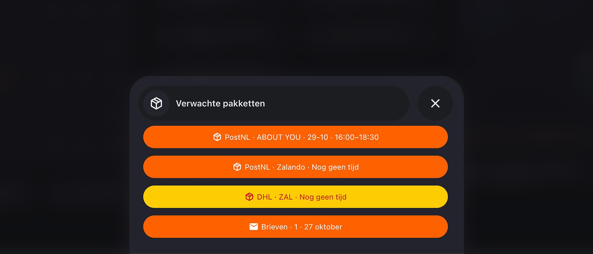

# Home Assistant cards

Dashboard cards to paste into your own dashboard. Each one is a separate YAML file.

## Files

| file | what it shows |
|---|---|
| [`pakketten_popup.yaml`](pakketten_popup.yaml) | A pop-up with every parcel on its way, and your PostNL letters |

## Parcels pop-up



Every parcel gets its own bar in the colour of the carrier. It shows who sent
it and when it arrives, for example `PostNL · Zalando · 5-11 · 15:45–18:15`.
For Amazon you see the product instead of the sender. Tap a bar to open the
tracking page of that parcel.

The pop-up only shows the parcels that are on their way, up to eight, and
grows and shrinks with them. The texts on the card are in Dutch.

### What you need

Install these through [HACS](https://hacs.xyz):

| what | why |
|---|---|
| [Bubble Card](https://github.com/Clooos/Bubble-Card) | the pop-up itself, version 3.2 or newer |
| [Parcel Aggregator](https://github.com/ha-parcel-integrations/ha-parcel-aggregator) | collects the parcels of all your carriers in one place |
| one or more carriers below | your parcels |

| carrier | colour on the card |
|---|---|
| [PostNL](https://github.com/ha-parcel-integrations/ha-postnl) | orange, also for the letters |
| [DHL NL](https://github.com/ha-parcel-integrations/ha-dhl-nl) | yellow |
| [DPD](https://github.com/ha-parcel-integrations/ha-dpd) | red |
| [Dragonfly](https://github.com/ha-parcel-integrations/ha-dragonfly) | dark blue |
| [Amazon](https://github.com/ha-parcel-integrations/ha-amazon) | dark with orange text |

Other carriers that the Parcel Aggregator supports also show up, in the colour
of your theme.

### Adding the pop-up

1. Open your dashboard, choose **Edit dashboard**, add a card and pick
   **Manual**.
2. Paste [`pakketten_popup.yaml`](pakketten_popup.yaml) and save. The pop-up
   stays hidden until you open it, so you see no new card yet.
3. Check two names in what you pasted. You find yours under **Settings >
   Devices & services > Entities**.
   - `sensor.parcel_aggregator_inkomende_pakketten`: the incoming parcels of
     the Parcel Aggregator. With Home Assistant in English it is probably
     `sensor.parcel_aggregator_incoming_parcels`. Replace it everywhere in the
     card.
   - `sensor.postnl_jouw_account_brieven`: your PostNL letters. Replace it with
     yours, or remove the last part of the card if you don't want letters.

### Opening the pop-up

The pop-up opens from any card on the same dashboard page that navigates to
`#pakketten`. A tile with the number of parcels works well:

```yaml
type: tile
entity: sensor.parcel_aggregator_inkomende_pakketten
name: Verwachte pakketten
tap_action:
  action: navigate
  navigation_path: "#pakketten"
```

In the visual editor: set **Tap behavior** to **Navigate** and type
`#pakketten` as the path. Close the pop-up with the cross or by tapping next to
it.

### Good to know

- **A tap shows the parcel list instead of the tracking page.** The links run
  through a small script inside the card. If it doesn't run, a tap opens the
  parcel list of the Parcel Aggregator instead.
- **The bar says `Pakket`.** That carrier does not pass on who sent the parcel.
- **Other colours.** The colours are listed under `kleuren`, once for each of
  the eight parcels. Change them in all eight, or add a carrier there with its
  own colour.
